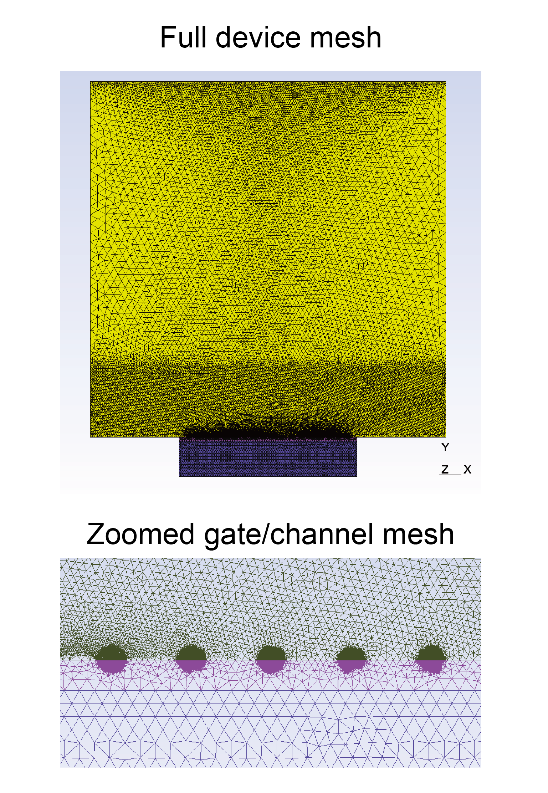
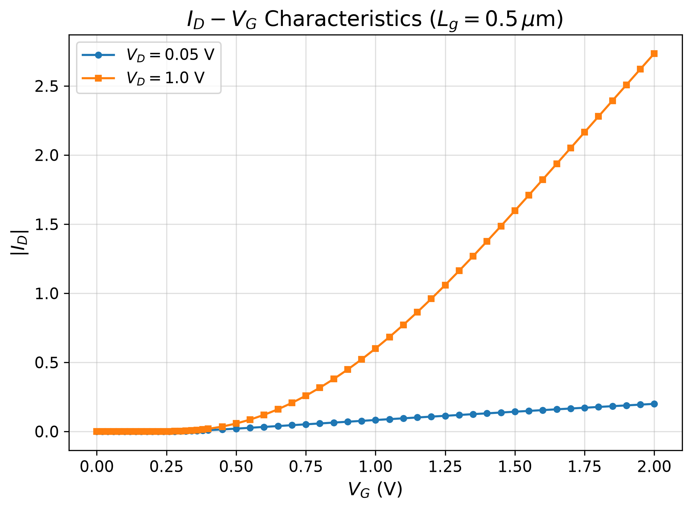
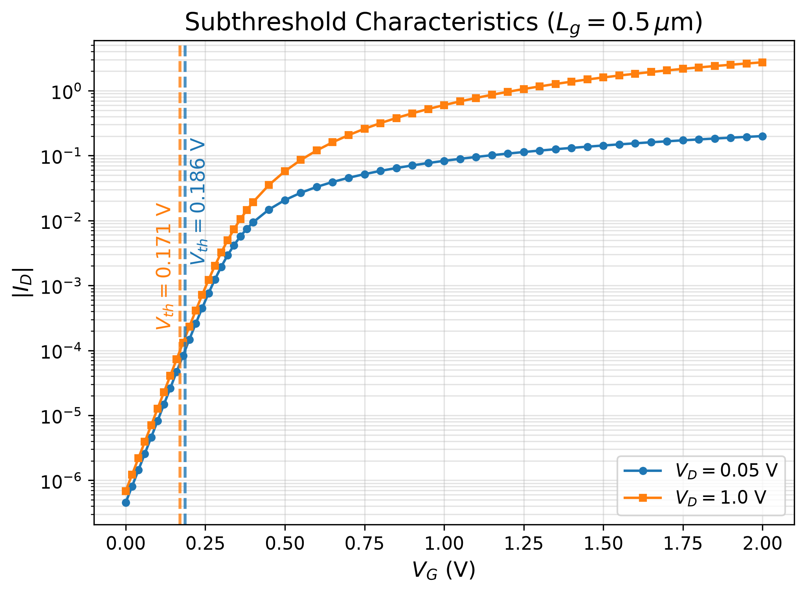
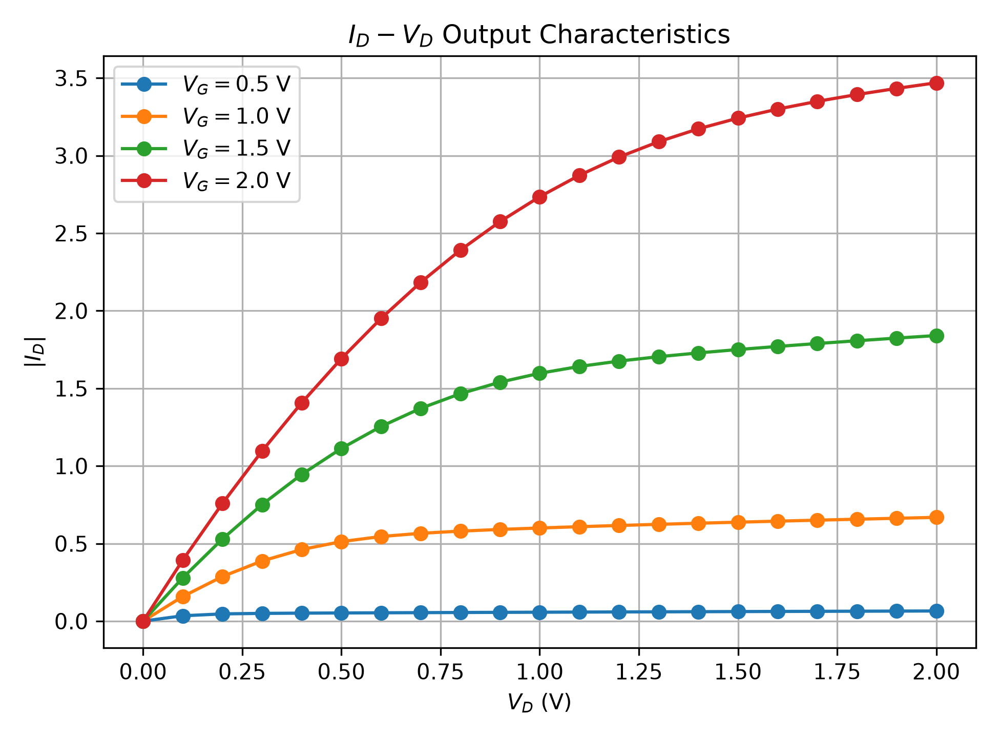
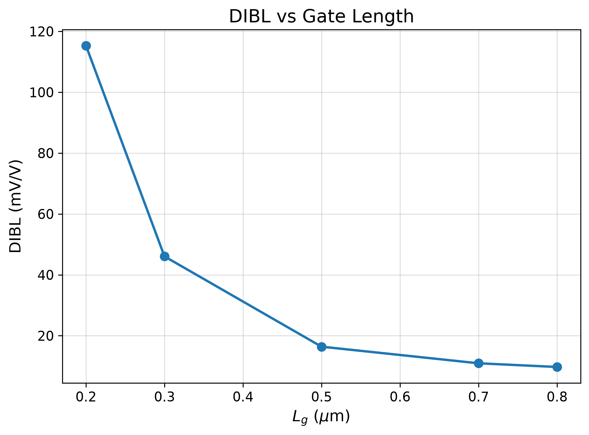
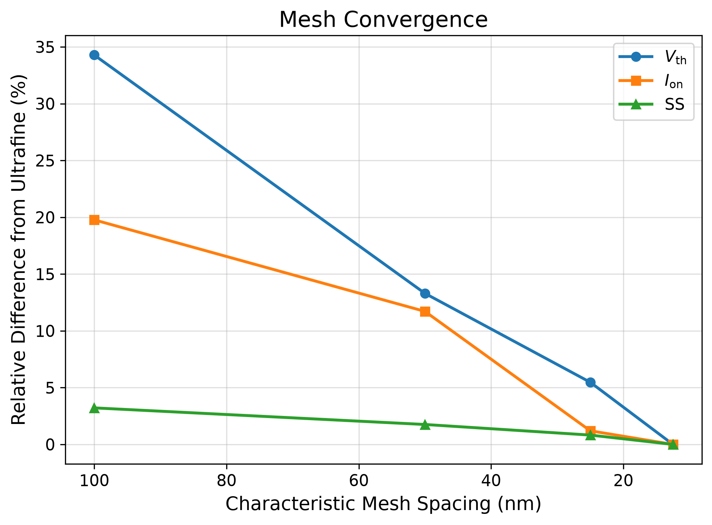

# 2D Si nMOSFET TCAD Simulation with DEVSIM

This project implements and analyzes a two-dimensional silicon nMOSFET using
DEVSIM, Python, and Gmsh. The study focuses on electrostatic short-channel
effects, transfer/output characteristics, extracted compact metrics, and mesh
refinement sensitivity.

The simulated gate lengths are:

| Gate length | Value |
| --- | ---: |
| Short-channel devices | 0.2, 0.3 um |
| Baseline / intermediate device | 0.5 um |
| Longer-channel devices | 0.7, 0.8 um |

The production simulations use a characteristic mesh spacing of 25 nm after a
mesh-refinement study. Current values reported by the simulator are interpreted
in the native DEVSIM two-dimensional simulation normalization; they should not
be read directly as absolute terminal current in amperes. The analysis therefore
emphasizes relative trends, parameter extraction, and device scaling behavior.

## Overview

The objective is to build a reproducible TCAD-style workflow for a 2D Si
nMOSFET and use it to extract key device metrics:

- Threshold voltage, `Vth`
- Subthreshold swing, `SS`
- Drain-induced barrier lowering, `DIBL`
- On-current, `Ion`
- Off-current, `Ioff`
- Transconductance, `gm`

The main simulated bias sweeps are:

- `Id-Vg` at low drain bias, `Vd = 0.05 V`
- `Id-Vg` at high drain bias, `Vd = 1.0 V`
- `Id-Vd` at `Vg = 0.5, 1.0, 1.5, 2.0 V`

The resulting dataset captures the expected increase in short-channel effects
as gate length is reduced, most clearly through the rise in DIBL and leakage
current for the shortest devices.

## Device Structure

The device is a two-dimensional silicon nMOSFET with a locally refined
gate/channel mesh. Gmsh is used to generate the geometry and mesh, while DEVSIM
solves the semiconductor equations on the generated structure.

The mesh is refined near the gate/channel region and the Si/SiO2 interface,
where electrostatic potential and carrier-density gradients are strongest.

<p align="center">
  
</p>

**Figure 1.** Two-dimensional Si nMOSFET structure and computational mesh. The
figure shows both the full device mesh and the refined gate/channel region.
Local refinement is applied near the gate/channel region and Si/SiO2 interface.

## Physical Model

The simulation uses a drift-diffusion semiconductor formulation appropriate for
DC MOSFET characterization. The model solves the coupled electrostatic and
carrier-transport problem under applied gate and drain bias.

The core physical quantities are:

- Electrostatic potential
- Electron and hole carrier densities
- Electron and hole current continuity
- Terminal current response under gate and drain bias sweeps

The model is intended for comparative device analysis rather than calibrated
process-accurate prediction. In particular, the reported current magnitudes are
kept in native two-dimensional simulation normalization, and the main physical
interpretation is based on trends across bias, gate length, and mesh density.

## Simulation Workflow

The workflow is organized as follows:

1. Define the 2D MOSFET geometry and material regions.
2. Generate the computational mesh in Gmsh.
3. Import the mesh into the DEVSIM/Python simulation flow.
4. Apply contact, material, and bias definitions.
5. Solve DC operating points for transfer and output sweeps.
6. Extract `Vth`, `SS`, `DIBL`, `Ion`, `Ioff`, and `gm`.
7. Repeat the sweep for gate lengths of 0.2, 0.3, 0.5, 0.7, and 0.8 um.
8. Perform mesh refinement using 100, 50, 25, and 12.5 nm characteristic mesh
   spacing.
9. Compare trends and convergence behavior.

## Results

### Transfer Characteristics

The transfer curves show the expected increase in drain current as gate voltage
increases. Comparing low and high drain bias reveals a clear threshold-voltage
shift, especially for shorter gate lengths.

<p align="center">
  
</p>

**Figure 2.** Linear-scale `Id-Vg` characteristics using the 25 nm production
mesh.

<p align="center">
  
</p>

**Figure 3.** Semi-log `Id-Vg` characteristics using the 25 nm production mesh.
The semi-log view highlights subthreshold behavior and off-state leakage.

The low-drain-bias threshold voltage increases with gate length:

| Gate length `Lg` (um) | Low-`Vd` `Vth` (V) | `Ioff` (native current units) |
| ---: | ---: | ---: |
| 0.2 | -0.012 | 1.38e-4 |
| 0.3 | 0.108 | 4.41e-6 |
| 0.5 | 0.186 | 4.55e-7 |
| 0.7 | 0.214 | 2.05e-7 |
| 0.8 | 0.223 | 1.61e-7 |

The shortest device has the largest leakage and the lowest extracted threshold
voltage, consistent with stronger source/drain electrostatic coupling.

### Output Characteristics

The output characteristics were simulated at gate biases of `Vg = 0.5, 1.0,
1.5, 2.0 V`.

<p align="center">
  
</p>

**Figure 4.** `Id-Vd` family using the 25 nm production mesh.

As gate bias increases, the channel charge increases and the drain current rises
accordingly. The curves provide the basis for comparing drive-current behavior
across gate bias while preserving the same native simulation current
normalization.

### DIBL Scaling with Gate Length

DIBL was extracted from the threshold-voltage shift between `Vd = 0.05 V` and
`Vd = 1.0 V`:

```text
DIBL = (Vth_lowVd - Vth_highVd) / (1.0 V - 0.05 V)
```

The values below are reported in mV/V after multiplying the extracted V/V ratio
by 1000.

<p align="center">
  
</p>

**Figure 5.** DIBL versus gate length using the 25 nm production mesh.

The extracted DIBL values are:

| Gate length `Lg` (um) | DIBL (mV/V) |
| ---: | ---: |
| 0.2 | 115.31 |
| 0.3 | 46.06 |
| 0.5 | 16.40 |
| 0.7 | 10.94 |
| 0.8 | 9.73 |

The trend is monotonic: DIBL increases rapidly as gate length is reduced. The
0.2 um device shows the strongest short-channel effect, while the 0.7-0.8 um
devices are comparatively well controlled by the gate.

## Mesh Convergence

Mesh refinement was evaluated using characteristic spacings of:

| Mesh label | Characteristic spacing |
| --- | ---: |
| Coarse | 100 nm |
| Medium | 50 nm |
| Fine | 25 nm |
| Ultrafine | 12.5 nm |

<p align="center">
  
</p>

**Figure 6.** Mesh-convergence comparison for the MOSFET simulation.

The 25 nm fine mesh was selected as the production baseline because the
fine-to-ultrafine change is small while the computational cost is lower than the
12.5 nm mesh.

Observed fine-to-ultrafine differences:

| Metric | Fine to ultrafine difference |
| --- | ---: |
| `Vth` | about 10.8 mV |
| `Ion` | about 1.2% |
| `SS` | about 0.82% |

For the baseline fine-mesh device, the extracted DIBL is about 16.40 mV/V. This
value is consistent with the gate-length sweep result for the 0.5 um device and
supports using the 25 nm mesh for the main scaling analysis.

## Numerical Validation

Several consistency checks support the numerical reliability of the final
results:

- The `Id-Vg` curves show physically reasonable monotonic turn-on behavior.
- The semi-log transfer curves expose the expected subthreshold region and
  leakage increase for shorter gate lengths.
- The `Id-Vd` family increases with gate bias, matching MOSFET drive-current
  expectations.
- Extracted DIBL decreases monotonically as `Lg` increases from 0.2 to 0.8 um.
- Mesh refinement from 25 to 12.5 nm changes `Ion` and `SS` by only about 1.2%
  and 0.82%, respectively.
- The fine-mesh baseline DIBL value of about 16.40 mV/V is consistent with the
  0.5 um gate-length result.

These checks do not make the simulation fully process-calibrated, but they show
that the computed trends are internally consistent and mesh-stable enough for
comparative device analysis.

## Limitations

This project is a compact TCAD-style study and has several intentional
limitations:

- The simulation is two-dimensional, so terminal current values remain in native
  2D simulation normalization rather than direct measured amperes.
- The device is not calibrated against experimental silicon data.
- Advanced short-channel and nanoscale effects such as mobility degradation,
  velocity saturation, quantum confinement, interface traps, and self-heating may
  require additional model calibration or extensions.
- The mesh study validates the selected production mesh for the present metrics,
  but more aggressive geometry changes may require a new convergence check.
- Absolute `Ion` and `Ioff` values should be compared only within the same
  simulation setup and normalization.

## Conclusion

This project demonstrates a full DEVSIM/Python/Gmsh workflow for 2D Si nMOSFET
simulation and analysis. The final production mesh uses a 25 nm characteristic
spacing, selected from a 100/50/25/12.5 nm refinement study.

The extracted results show clear short-channel behavior. As gate length is
reduced from 0.8 to 0.2 um, DIBL increases from 9.73 to 115.31 mV/V, low-drain
threshold voltage decreases from about 0.223 to -0.012 V, and off-state leakage
increases by nearly three orders of magnitude in native simulation current
normalization.

Overall, the simulation captures the expected MOSFET scaling trends and provides
a numerically stable baseline for further model refinement, calibration, or
device-design exploration.
